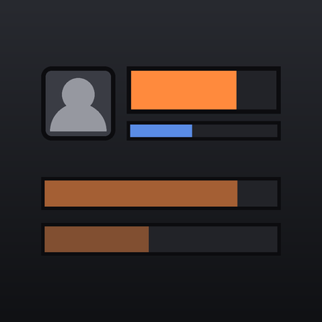
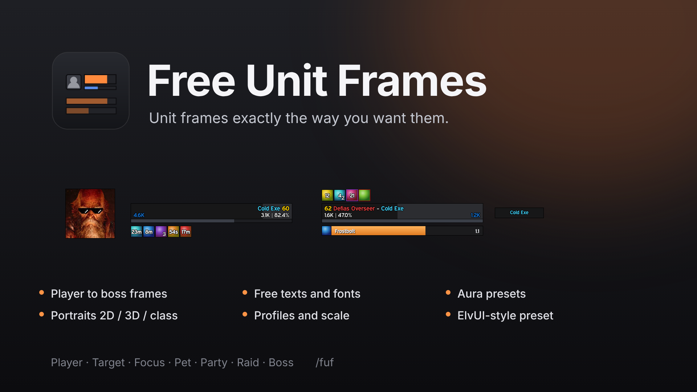
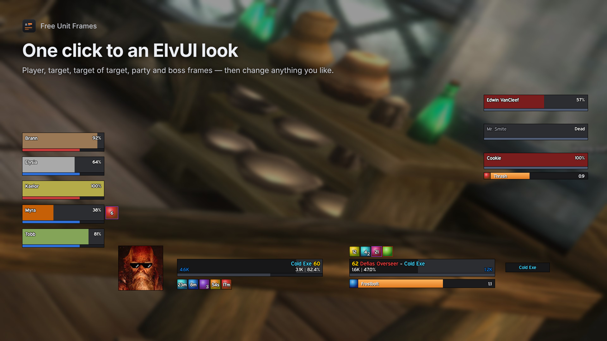
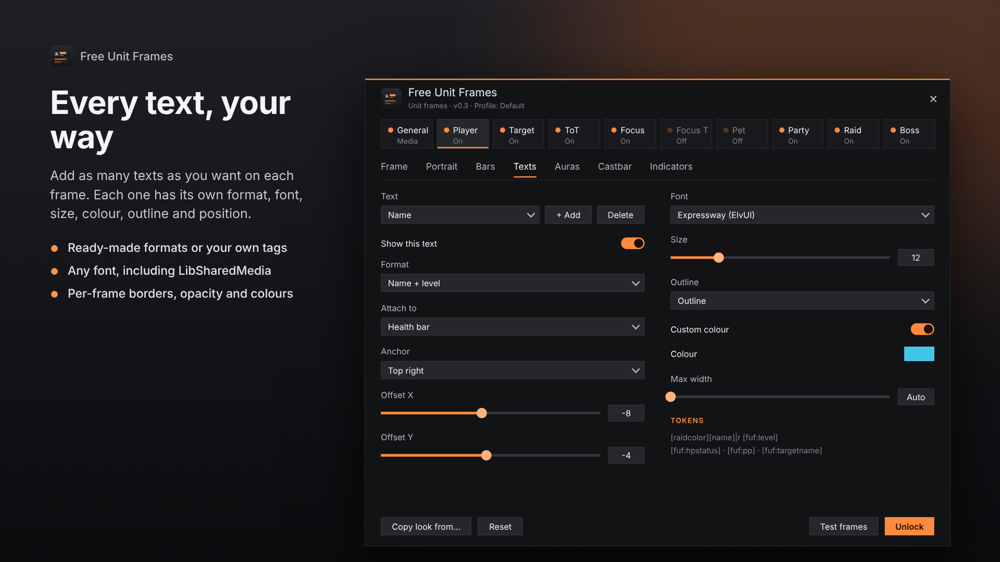
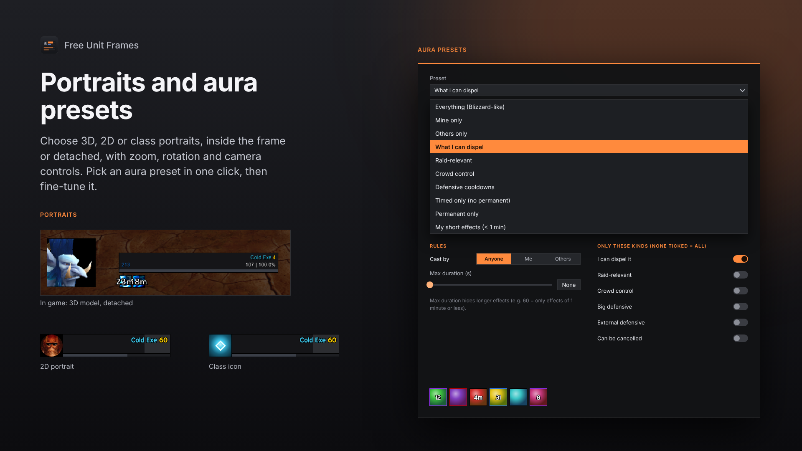
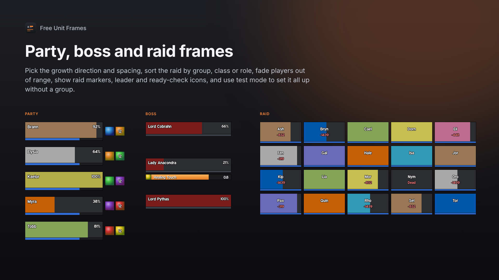

<h1 align="center">Free Unit Frames</h1>

Fully customisable unit frames for player, target, focus, party, raid and bosses, with an ElvUI-style preset in one click.

<a href="https://www.curseforge.com/wow/addons/freeunitframes"><b>Download on CurseForge</b></a> · version <b>0.10.0</b> · WoW Forever (1.60.1) · <code>/fuf</code>

## Screenshots

<table>
<tr>
<td width="50%" valign="top"> <b>ElvUI-style preset</b> Player, target, target of target, party and boss frames after one click on the preset.</td>
<td width="50%" valign="top"> <b>Texts</b> Add as many texts as you want, each with its own format, font, size, colour and outline.</td>
</tr>
<tr>
<td width="50%" valign="top"> <b>Portraits and aura presets</b> 3D, 2D or class portraits, inside or detached. Aura presets in one click.</td>
<td width="50%" valign="top"> <b>Party, boss and raid</b> Growth, spacing, sorting, range fading and test mode.</td>
</tr>
</table>

**Unit frames for every unit — player to boss — that you can shape however you like, without installing a full UI suite.**

Free Unit Frames replaces the default unit frames with clean, flat frames built on oUF, the same library ElvUI uses. Every frame has its own size, position, bars, texts, portrait, auras, castbar and border, and everything is changed from a single options window with live results.

## One click to an ElvUI look

Not sure where to start? Open the options, click **Apply ElvUI dark** on the General page, and your player, target and target of target frames get the familiar dark ElvUI look: thin bars, class-coloured names, yellow levels, abbreviated health and mana. Then change anything you like.

## What you can customise

| Area | What you get |
|---|---|
| **Frames** | Player, target, target of target, focus, focus target, pet, party, raid and boss. Size, scale (for all frames and per frame), position (drag and drop), opacity, border on or off per frame. |
| **Bars** | Health and power: textures, class or reaction colours, custom colours, background colour or tint, vertical or reversed fill, power bar on any side. |
| **Texts** | As many texts as you want per frame. Ready-made formats (name, level, health, percent, mana, target name…) or your own tags. Own font, size, colour, outline, anchor, offsets and max width for each. |
| **Portraits** | 3D model, 2D portrait or class icon. Inside the frame, behind the bars or detached at any size. 3D camera: zoom, distance, position, rotation, pause, background on or off. |
| **Auras** | Buffs and debuffs with presets: everything (Blizzard-like), mine only, others only, what I can dispel, raid-relevant, crowd control, defensive cooldowns, short effects… Then size, per row, growth, spacing, duration numbers, stacks and border colour by type. |
| **Castbar** | Size, offsets, icon, spell name, cast time, colours (including uninterruptible) and border. |
| **Indicators** | Raid marker, leader, ready check, combat and resting icons, threat outline, combo points. |
| **Groups** | Party, raid and boss headers: growth direction, spacing, sorting by group, class or role, range fading, test mode to set them up without a group. |

## Profiles

Each character can use its own profile or share one. Create, copy, reset and delete profiles from the General page, and copy the look of one frame onto another in one click.

## Fonts

Around fifteen fonts come with the addon or the game, and every font list shows each font in its own typeface. **Want more fonts?** Install [SharedMedia Additional Fonts](https://www.curseforge.com/wow/addons/shared-media-additional-fonts) (or any LibSharedMedia font pack): its fonts appear automatically in the font lists of Free Unit Frames, Free Bars and Free Swing. If ElvUI is installed, its Expressway and Homespun fonts can be used too.

## Commands

- `/fuf` — open the options
- `/fuf unlock` — move the frames
- `/fuf test` — show test frames (party, raid, boss)
- `/fuf preset elvui` — apply the ElvUI-style preset
- `/fuf reset` — reset all frames

## Free Hub

Free Unit Frames works on its own. With **Free Hub** installed, its options open inside the hub next to the other Free addons, and a single minimap button replaces theirs.

## Notes

- Built for WoW Forever. On this client, auras go through the game's own aura system, so the buff and debuff preview is not available in test mode.
- Not affiliated with ElvUI. Free Unit Frames embeds oUF (MIT licence, included in the download).
- Bug reports and ideas are welcome in the comments.

## The Free suite

Addons for WoW Forever that share the same look, profiles and a single minimap button through Free Hub.

| | Addon | |
|---|---|---|
|  | **[Free Hub](https://github.com/DecardCainSuite/FreeHub)** — All the Free addons in one window: options side by side, product pages with gallery, and a single minimap button. | [CurseForge](https://www.curseforge.com/wow/addons/free-hub) |
|  | **[Free Unit Frames](https://github.com/DecardCainSuite/FreeUnitFrames)** (this one) — Fully customisable unit frames for player, target, focus, party, raid and bosses, with an ElvUI-style preset in one click. | [CurseForge](https://www.curseforge.com/wow/addons/freeunitframes) |
|  | **[Free Bars](https://github.com/DecardCainSuite/FreeBars)** — Up to 9 action bars, laid out as a grid or an arc, with mouseover fade, paging and a clean flat look. | [CurseForge](https://www.curseforge.com/wow/addons/freebars) |
|  | **[Free Swing](https://github.com/DecardCainSuite/FreeSwing)** — Swing timers for main hand, off hand and ranged, at exactly the size and style you want. | [CurseForge](https://www.curseforge.com/wow/addons/freeswing) |
|  | **[Free Minimap](https://github.com/DecardCainSuite/FreeMinimap)** — A rectangular minimap of any size, with a region map drawn from the game's own terrain tiles around you. | [CurseForge](https://www.curseforge.com/wow/addons/freeminimap) |
|  | **[Free Guild](https://github.com/DecardCainSuite/FreeGuild)** — Guild roster and rank tool for guild masters and officers: filters, bulk ranks, rules that promote for you, guild info and notes. | [CurseForge](https://www.curseforge.com/wow/addons/freeguild) |
|  | **[Free LFG](https://github.com/DecardCainSuite/FreeLFG)** — The group finder as a compact, sortable table: leader, roles, free slots, one-click whisper from a template, and live filters you write yourself. | [CurseForge](https://www.curseforge.com/wow/addons/freelfg) |

## Changelog

What is new in the current version: [CHANGELOG.md](CHANGELOG.md). Full history: [CHANGELOG-history.md](CHANGELOG-history.md).

## Repository layout and releases

- The repository root is the addon folder (`FreeUnitFrames/`), as installed in `Interface\AddOns`.
- `curseforge/` holds the CurseForge page: `description.md` (fields, gallery captions, description) and `images/` (logo, gallery, social preview). It is not shipped in the addon zip.
- `CHANGELOG.md` holds the notes of the version being prepared; they are sent to CurseForge as the file's changelog.
- Releasing: bump `## Version` in `FreeUnitFrames.toc`, write `CHANGELOG.md`, then publish a GitHub release named `v<version>`. GitHub Actions packages the addon with the [BigWigs packager](https://github.com/BigWigsMods/packager) and uploads it to CurseForge and to the GitHub release.

Bug reports and ideas are welcome in the issues or in the CurseForge comments.
